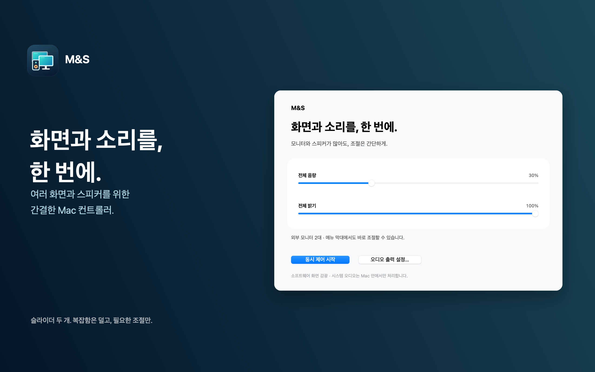

# M&S · 화면과 소리를, 한 번에.

여러 모니터와 스피커를 함께 쓰는 Mac을 위한 간결한 메뉴 막대 앱입니다.

- 외부 모니터들의 화면을 슬라이더 하나로 함께 어둡게 조절
- 다중 출력 기기에 연결한 스피커들의 음량을 함께 조절
- 전체 음소거와 간단한 제어 패널
- 계정 가입·광고·구독 없이, Mac 안에서 처리

**판매 준비 중입니다.** Mac App Store의 한국 판매 가격은 1회 구매 **1,000원**으로 준비하고 있습니다. 현재 App Store에서 판매가 시작된 상태는 아닙니다.

화면 밝기는 소프트웨어 감광이며 모니터의 백라이트나 소비 전력을 조절하지 않습니다. 음량 동시 제어는 macOS의 다중 출력 기기 설정과 시스템 오디오 권한이 필요합니다. macOS 14.2 이상을 지원하며, 화면·오디오 환경에 따라 사용 가능 여부가 달라집니다.

[사용 방법 및 지원](SUPPORT.md) · [개인정보 처리방침](PRIVACY.md)

